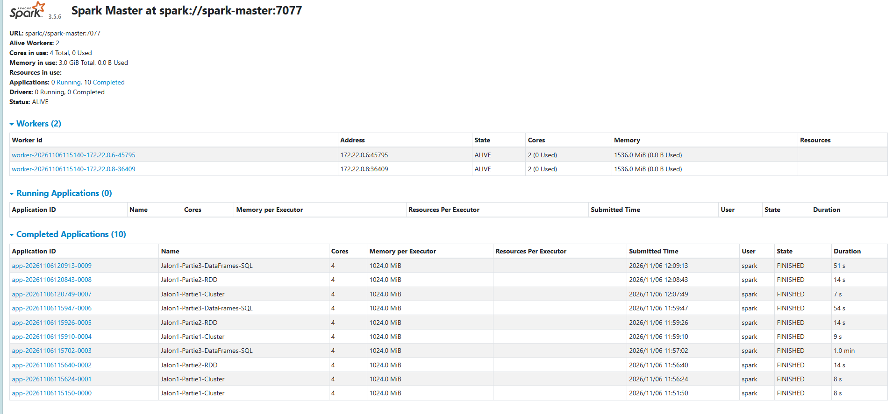
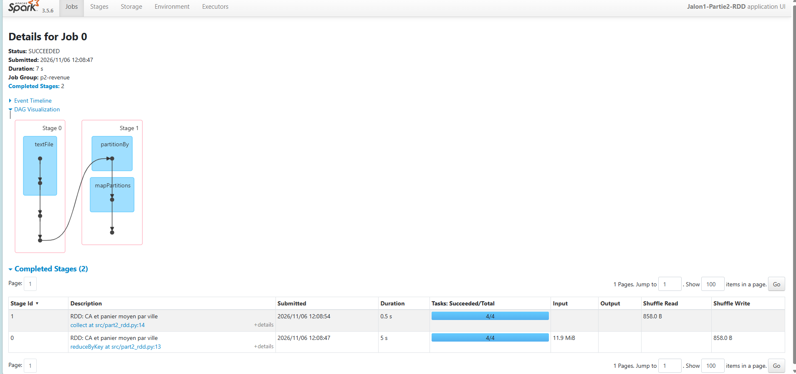
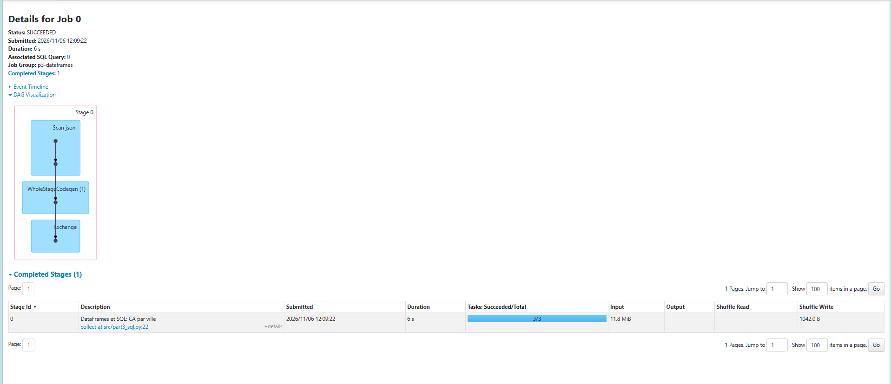
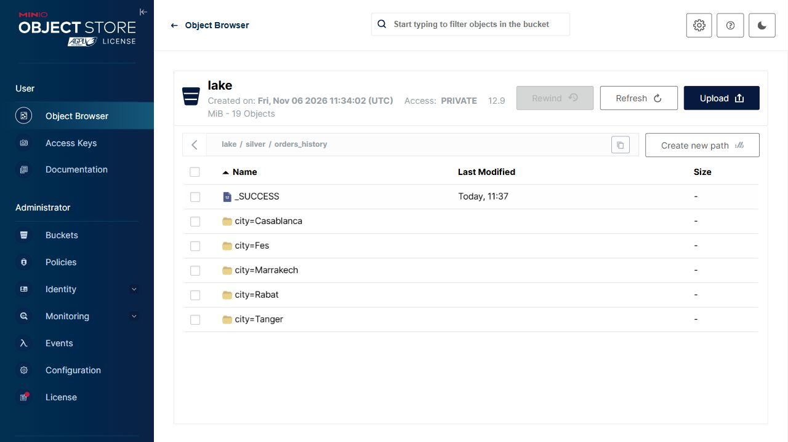
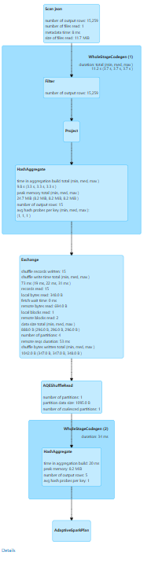
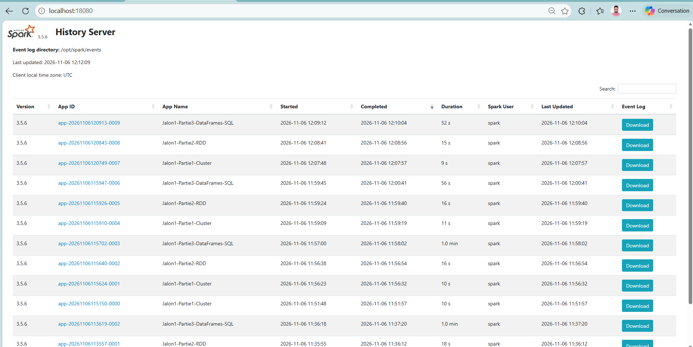

# Jalon 1 | Cluster et analyses batch

Écosystème Big Data 2 - EMSI - 2026/2027
**Binôme : noms à renseigner.** Exécution vérifiée le 6 novembre 2026 (UTC).

## Partie 1 - Déploiement et positionnement

Docker Compose déploie Kafka en KRaft, un Spark Master, deux Workers, MinIO et Jupyter. Un History Server conserve les interfaces des applications terminées. Spark 3.5.6, Scala 2.12 et Python 3.8.10 sont identiques côté Driver et Executors ; Hadoop 3.3.4 fournit le connecteur S3A. MinIO est reconstruit depuis son tag officiel documenté dans le README.

| Élément | Rôle dans ce déploiement |
| --- | --- |
| Driver | Programme Python lancé dans Jupyter ; construit le plan et coordonne les tâches. |
| SparkContext | Point de connexion de l’application au cluster ; porte les RDD et la planification. |
| Cluster Manager | Le Master standalone alloue les ressources ; les deux Workers lancent les Executors. |
| Executors | Processus propres à chaque application ; exécutent les tâches, échangent les partitions et stockent les données persistées. |

**Deux limites de MapReduce.** (1) Les chaînes de jobs matérialisent souvent leurs intermédiaires sur disque : Spark permet leur réutilisation en mémoire, utile pour les analyses successives et les algorithmes de graphe. (2) Le modèle batch et les coûts de lancement conviennent mal aux indicateurs quasi temps réel : Structured Streaming fournira les micro-batches Kafka du jalon 2. Spark conserve néanmoins des E/S et des shuffles ; la mémoire ne supprime pas tous les coûts.

**Preuves :** 2 Workers actifs, 4 cœurs annoncés, topic orders à 3 partitions et bucket lake. La session Jalon1-Partie1-Cluster utilise spark://spark-master:7077. La somme distribuée 0..999 vaut 499500. sc.defaultParallelism=4 désigne les partitions par défaut, pas une mesure matérielle.

Figure 1 - Capture fournie : deux Workers ALIVE, quatre cœurs disponibles et applications terminées.



Référence : documentation Apache Spark 3.5.6, Cluster Mode Overview (lien dans le README).


---

# Partie 2 | Analyse en RDD

## Données et sémantique des indicateurs

Le générateur de remplacement, autorisé par l’utilisateur, produit 50 000 événements et 200 restaurants (graine 2026). Ce ne sont pas les fichiers officiels du cours. Il injecte 1 000 doublons exacts et 2480 événements originaux retardés, soit 5,06 %, avec un retard maximal de 15 minutes. Les fichiers sont copiés sous lake/bronze/history/ et lake/bronze/reference/.

Le filtre conserve uniquement DELIVERED. Les montants sont additionnés en centimes entiers ; le panier moyen résulte du couple (somme, nombre) agrégé par reduceByKey. Les doublons restent présents dans les parties 2/3 pour respecter la progression vers le dédoublonnage de la partie 5. Les chiffres ci-dessous sont donc des **indicateurs événementiels**.

| Ville | CA (MAD) | Livraisons | Panier moyen (MAD) |
| --- | --- | --- | --- |
| Casablanca | 560 360,22 | 2997 | 186,97 |
| Fes | 577 256,65 | 3100 | 186,21 |
| Marrakech | 580 136,75 | 3106 | 186,78 |
| Rabat | 572 186,57 | 3064 | 186,74 |
| Tanger | 562 751,73 | 2992 | 188,09 |

**Total :** 15 259 événements DELIVERED, soit 2 852 691,92 MAD.

## Top 5 des restaurants

| Restaurant | Événements livrés |
| --- | --- |
| R-032 | 101 |
| R-070 | 97 |
| R-059 | 95 |
| R-187 | 95 |
| R-097 | 94 |

takeOrdered trie par nombre décroissant puis identifiant croissant pour départager les ex aequo de façon reproductible.

## Transformations, actions et tolérance aux pannes

**Transformations différées :** textFile définit la source, puis map(json.loads), filter, map et reduceByKey construisent le lineage. **Actions :** collect, count et takeOrdered déclenchent les jobs. toDebugString décrit les dépendances sans calculer les résultats.

reduceByKey regroupe les mêmes villes entre partitions : la redistribution provoque un shuffle. Une combinaison locale réduit les données transférées avant l’agrégation finale. Le lineage mémorise la suite des transformations ; une partition perdue peut être recalculée depuis ses dépendances, tant que les sources sont encore accessibles. Ce mécanisme ne rend pas le Master unique hautement disponible.

```text
textFile -> map(parse JSON) -> filter(DELIVERED)
         -> map(city, (centimes, 1))
         -> reduceByKey(somme des couples) -> collect
```


---

# Plans et exécution distribuée

## DAG RDD réellement observé

Figure 2 - Capture fournie du Job 0 RDD : deux stages et quatre tâches par stage.



Le job 0 comporte 2 stages : lecture/transformations et écriture du shuffle, puis agrégation/collecte. L’interface indique 858 octets écrits et relus par le shuffle. Le script de la partie 2 totalise 5 jobs et 8 stages terminés : CA, panier moyen, top 5 et deux comptages. Ces nombres proviennent des journaux, pas d’une estimation.

## DAG du premier job DataFrame

Figure 3 - Capture fournie du Job 0 DataFrame : Scan json, WholeStageCodegen et Exchange.



Ce job comporte un stage et trois tâches, avec 1 042 octets écrits dans le shuffle. Ce nombre décrit le job affiché, pas toute la requête SQL. Le lien Associated SQL Query mène au plan complet, présenté en page 6. AQE peut réutiliser un stage déjà calculé : « skipped » ne signifie pas « failed ».

Applications documentées par ces captures : app-20261106120843-0008 (RDD) et app-20261106120913-0009 (DataFrames/SQL).


---

# Partie 3 | SQL, jointures et Parquet

## Schémas explicites et qualité

Les JSON sont lus avec StructType et mode FAILFAST, sans inférence. Les identifiants, ville et statut sont StringType ; amount_mad est DecimalType(12,2), items_count IntegerType, distance_km DoubleType et event_time TimestampType en UTC. Le référentiel déclare identifiant, nom, ville, catégorie, latitude et longitude. Les schémas complets sont dans src/common.py.

Le contrôle du référentiel vérifie 200 identifiants distincts, aucune commande orpheline, aucune multiplication de lignes et la cohérence des villes après jointure. Silver écarte les valeurs requises manquantes et les valeurs métier invalides, ajoute distance_band et conserve les doublons. Toutes les lignes synthétiques satisfont ces règles : **50 000 en entrée, 50 000 jointes et 50 000 relues en Parquet**.

## CA par catégorie et par ville (MAD)

| Ville | burger | marocain | pizza | sushi | tacos |
| --- | --- | --- | --- | --- | --- |
| Casablanca | 112 716,08 | 116 921,72 | 114 729,30 | 100 013,67 | 115 979,45 |
| Fes | 115 291,72 | 117 729,42 | 121 641,97 | 118 309,95 | 104 283,59 |
| Marrakech | 120 508,70 | 117 279,99 | 107 086,31 | 111 384,25 | 123 877,50 |
| Rabat | 115 266,10 | 111 478,93 | 114 593,88 | 112 516,83 | 118 330,83 |
| Tanger | 108 976,15 | 113 124,63 | 117 143,42 | 107 363,02 | 116 144,51 |

Le CA est recalculé avec groupBy/agg puis avec createOrReplaceTempView et spark.sql. Les deux résultats sont exactement égaux aux RDD et au contrôle indépendant Python, au centime près.

## Stockage Silver partitionné

Chemin : s3a://lake/silver/orders_history/. Format Parquet compressé Snappy, partitionnement city. Une relecture vérifie le nombre de lignes, les cinq villes et le CA. Une relance remplace uniquement cette sortie batch du projet ; les entrées Bronze et les autres conteneurs sont conservés.

Figure 4 - Cinq partitions city=... et marqueur _SUCCESS. Capture MinIO de l’exécution initiale conservée ; mêmes données synthétiques.




---

# Mesures, comparaison et validation

## Protocole et temps observés

Mesures sur le même JSON dans MinIO, quatre cœurs d’Executors, sans cache() explicite. Une chauffe précède trois actions chronométrées ; l’ordre est décalé entre répétitions. Les caches système/JVM/S3 peuvent rester chauds. Les coûts initiaux de démarrage ne sont pas confondus avec ces mesures. Le faible volume et le cluster local ne permettent pas une extrapolation industrielle.

| Calcul | 3 mesures (secondes) | Médiane (s) |
| --- | --- | --- |
| RDD | 0.691 / 0.601 / 0.596 | 0.601 |
| DataFrame | 0.524 / 0.556 / 0.347 | 0.524 |
| SQL | 0.527 / 0.428 / 0.346 | 0.428 |
| UDF | 0.610 / 0.535 / 0.498 | 0.535 |
| Native | 0.500 / 0.487 / 0.450 | 0.487 |

Pour cette exécution (app-20261106120913-0009), l’ordre des médianes croissantes est : SQL, DataFrame, RDD. DataFrame et SQL partagent le moteur Spark SQL ; ce classement local ne garantit pas un ordre universel. La première action (RDD : 9.990 s ; DataFrame : 15.209 s) inclut des coûts initiaux différents et ne constitue pas une comparaison équitable des API.

## RDD, DataFrame et Dataset

| API | Typage et optimisation | Utilisation ici |
| --- | --- | --- |
| RDD | Objets Python dynamiques ; contrôle explicite des transformations ; pas d’optimisation relationnelle Catalyst. | Parsing, filter, reduceByKey et lineage. |
| DataFrame / SQL | Colonnes avec schéma ; Catalyst optimise le plan. Tungsten et génération de code optimisent l’exécution JVM. | Jointures, agrégations, Parquet ; mesures ci-dessus. |
| Dataset[T] | API typée Scala/Java avec encodeurs, utilisant le moteur SQL ; API Dataset typée absente de PySpark. | Comparaison théorique : aucun temps Dataset inventé. |

## UDF Python et expression native

Règles vérifiées : court si distance &lt; 2 km ; moyen de 2 à 5 km inclus ; long au-delà de 5 km ; null reste null. Tests sur null, 1,99, 2, 5 et 5,01 km. Les deux méthodes donnent 6 480 courts, 10 695 moyens et 32 825 longs. La version native évite les échanges Python/JVM et reste visible par l’optimiseur. Le test agrège réellement la colonne produite : un simple count() pourrait la supprimer du plan.

## Validation et limites du jalon

**PASS :** montants exacts, paniers moyens, top 5, CA par catégorie, classes de distance, intégrité du référentiel et relecture Parquet. Les scripts/notebook et captures accompagnent ce rapport. L’exécution complète de la partie 3 comprend 72 jobs et 76 stages terminés, mesures et contrôles inclus. Aucune mesure de panne n’est revendiquée au jalon 1. Kafka streaming, Gold, Delta Lake et graphes restent au jalon 2.

Références : cahier des charges fourni, sections 3.1 à 3.3 ; documentation Apache Spark 3.5.6 (RDD Programming Guide, Cluster Mode Overview, Spark SQL Guide et Cloud Integration). Liens et versions détaillés dans README.md. Les captures proviennent du cluster exécuté le 06/11/2026.


---

# Historique et plan SQL complet

Les captures fournies montrent la dernière série terminée : parties 1, 2 et 3 aux identifiants se terminant par 0007, 0008 et 0009. Le plan ci-dessous concerne le chiffre d’affaires par ville ; la jointure avec les restaurants est documentée séparément par explain(True).





Le plan du CA suit : Scan JSON / Filter -> HashAggregate partiel -> Exchange -> AQEShuffleRead -> HashAggregate final (5 villes). WholeStageCodegen regroupe les opérateurs dans du code JVM généré.

La capture SQL fournie est de faible résolution (192 x 716 pixels) ; les petites métriques peuvent nécessiter la consultation de Spark History.

Pour la jointure, Parsed/Analyzed résout les colonnes et types ; Optimized fusionne les projections et ajoute isnotnull ; Physical utilise BroadcastHashJoin, BuildRight et BroadcastExchange. Voir results/part3_explain_join.txt pour la sortie complète.
