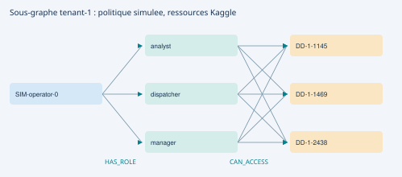

# SaaS multi-tenant | Jalons 1 et 2

Écosystème Big Data 2 - EMSI - 2026/2027<br/><b>Binôme : noms à renseigner.</b> Exécutions du 14 novembre 2026 (UTC).

## Source externe et périmètre

Dataset <b>DoorDash ETA Prediction, Kaggle, version 1</b> : 197 428 livraisons de restaurants de 2015. La source indique avoir ajouté du bruit pour masquer des détails commerciaux. Référence et licence déclarée MIT dans DATASET.md. Aucun jeu de commandes entièrement inventé ne sert désormais de base aux résultats.

Sélection : 200 restaurants, 24 500 commandes et deux états observés par commande. Les 49 000 événements reçoivent 1 000 doublons et 5 % de retards pédagogiques. <b>USD conservés</b> ; city désigne un marché anonymisé. Distances et coordonnées inconnues restent nulles. Livreurs, clients et droits SaaS sont simulés et signalés.

## Partie 1 - Déploiement et rôles

| Composant | Rôle dans le cluster |
| --- | --- |
| Driver / Jupyter | Construit les plans et pilote les tâches. |
| SparkContext | Point d’entrée pour RDD, planification et connexion au cluster. |
| Master standalone | Alloue les ressources ; deux Workers lancent les Executors. |
| Executors | Exécutent les partitions, les échanges et les états des requêtes. |
| Kafka / MinIO | Trois partitions orders ; stockage Bronze, Silver, Gold et checkpoints. |

Le cluster annonce <b>deux Workers et quatre cœurs</b>. defaultParallelism=4 est un réglage de parallélisme, vérifié séparément des ressources matérielles. Chaque application utilise au plus quatre cœurs ; les interfaces sont locales.

<b>MapReduce :</b> les chaînes de jobs matérialisent souvent leurs intermédiaires sur disque, alors que Spark peut réutiliser des données en mémoire. Le batch et les coûts de lancement conviennent moins aux indicateurs fréquents ; les micro-batches Spark permettent ici une actualisation progressive. Spark conserve néanmoins des E/S et des shuffles.

Preuves : results/part1_cluster.json ; Spark Master http://localhost:8080 ; Kafka orders à trois partitions ; bucket lake.

# Partie 2 | Batch RDD

## Chiffre d’affaires événementiel et panier moyen

Filtre DELIVERED, montants additionnés en centimes entiers. Les parties 2 et 3 conservent les doublons pour comparer les API avant le dédoublonnage de la partie 5. Les valeurs ne représentent donc pas encore le CA des commandes uniques.

| Marché | CA (USD) | Événements livrés | Panier (USD) |
| --- | --- | --- | --- |
| Market-1 | 52,758.36 | 1667 | 31.65 |
| Market-2 | 314,594.75 | 12284 | 25.61 |
| Market-3 | 7,224.68 | 235 | 30.74 |
| Market-4 | 290,566.48 | 9780 | 29.71 |
| Market-5 | 9,246.22 | 389 | 23.77 |
| Market-6 | 14,561.81 | 649 | 22.44 |

<b>Total : 25,004 événements livrés ; 688,952.30 USD.</b>

| Top restaurant | Événements DELIVERED |
| --- | --- |
| DD-2-6865 | 387 |
| DD-2-314 | 381 |
| DD-2-1311 | 359 |
| DD-2-1686 | 331 |
| DD-2-6074 | 319 |

## Transformations, actions et shuffle

```text
textFile -> map(json.loads) -> filter(DELIVERED)
         -> map(city, (centimes, 1))
         -> reduceByKey(somme des couples) -> collect
```

textFile, map, filter et reduceByKey construisent un calcul différé ; collect, count et takeOrdered lancent les jobs. La combinaison locale réduit les échanges avant le regroupement par ville. Le shuffle sépare les stages. Le premier job comporte deux stages ; les dépendances du lineage permettent de recalculer une partition perdue depuis une source encore disponible.

Exécution complète : <b>5 jobs et 8 stages terminés</b>. Application app-20261114105804-0001. Le lineage est conservé dans results/part2_lineage.txt ; détails et DAG dans le History Server.

# Partie 3 | DataFrames et SQL

## Schéma explicite, jointure et qualité

StructType impose les colonnes et TimestampType, DecimalType(12,2), IntegerType, DoubleType. Lecture FAILFAST sans inférence. La jointure stream-static ultérieure réutilise le même référentiel. Les 200 identifiants restaurant sont uniques ; aucune commande orpheline ni multiplication de lignes n’est acceptée.

<b>50,000 lignes en entrée, 50,000 après jointure et 50,000 relues en Parquet.</b> Partitionnement city, compression Snappy. Les distances nulles sont conservées comme inconnues ; les bornes 2 et 5 km sont testées séparément.

| API / calcul | Trois mesures (s) | Médiane (s) |
| --- | --- | --- |
| RDD | 0.922 / 0.972 / 0.646 | 0.922 |
| DataFrame | 1.059 / 0.575 / 0.399 | 0.575 |
| SQL | 0.759 / 0.472 / 1.322 | 0.759 |
| UDF | 0.893 / 0.868 / 0.605 | 0.868 |
| Native | 0.592 / 0.882 / 0.530 | 0.592 |

Même entrée JSON, quatre cœurs, une chauffe et trois répétitions, ordre alterné et aucun cache() explicite. Des caches système/JVM/S3 peuvent persister. Les temps ne constituent pas un classement universel. L’action consomme la bande de distance pour éviter que Catalyst ne supprime l’UDF inutilisée.

| API | Typage / optimisation |
| --- | --- |
| RDD | Objets Python, transformations explicites ; pas de Catalyst relationnel. |
| DataFrame / SQL | Schéma, optimisation Catalyst, exécution JVM et génération de code. |
| Dataset[T] | API typée Scala/Java avec encodeurs ; pas d’équivalent typé en PySpark. |

## Lecture de explain(True)

```text
Parsed / Analyzed Logical Plan : jointure et resolution des types
Optimized Logical Plan : projections et filtres isnotnull
Physical Plan : BroadcastHashJoin [...], Inner, BuildRight
               +- BroadcastExchange
                  +- FileScan json [restaurants...]
```

La diffusion du référentiel est explicitement demandée et justifiée par ses 200 lignes. Parsed/Analyzed résolvent les expressions ; Optimized montre les réécritures de Catalyst ; Physical décrit la stratégie exécutée. La version native when/otherwise reste visible par l’optimiseur et évite les échanges Python/JVM.

RDD = DataFrame = SQL = oracle Python : montants, paniers, top 5 et catégories vérifiés. Plan complet : results/part3_explain_join.txt.

# Partie 4 | Micro-batches Kafka

## Source -> transformations -> sinks

```text
Kaggle -> producer (20 evenements/s) -> Kafka orders [3 partitions]
  readStream(kafka) -> from_json(schema)
      |-> console append : nouvelles lignes
      |-> groupBy(city,status) -> console complete
      |-> JSON brut + topic/partition/offset -> Bronze
      |-> nettoyage + watermark + dedup + reference -> Silver
```

Le flux est une <b>table infinie</b> : les nouvelles lignes enrichissent le résultat au fil du temps. Chaque requête possède son propre checkpoint. Bronze conserve le JSON original sous raw_json avec les métadonnées Kafka ; Silver enrichit et écrit du Parquet partitionné city/date.

| Mode | Usage et condition |
| --- | --- |
| append | Nouvelles lignes ; agrégats seulement lorsque leurs fenêtres sont finalisées. |
| update | Lignes modifiées à chaque trigger ; nécessite un sink compatible. |
| complete | Table de résultat entière à chaque trigger ; comptage ville/statut en console. |

<b>Micro-batch :</b> trigger(processingTime="5 seconds") lance des lots, avec garanties possibles exactly-once si source et sink conviennent. <b>Continu :</b> trigger(continuous=...) vise une faible latence avec garanties at-least-once et un sous-ensemble d’opérations ; les agrégations avec état de ce pipeline utilisent les micro-batches.

| Requête | Lots non vides | Trigger maximal (ms) |
| --- | --- | --- |
| bronze | 21 | 11724 |
| silver | 19 | 17882 |
| raw_console | 4 | 8999 |
| counts_console | 5 | 15170 |

## Extrait de console et preuve des lots

| Console brute : batch | Lignes entrantes | Horodatage UTC |
| --- | --- | --- |
| 1 | 123 | 2026-11-14T11:00:30.001Z |
| 2 | 200 | 2026-11-14T11:00:40.000Z |
| 3 | 200 | 2026-11-14T11:00:50.000Z |
| 4 | 97 | 2026-11-14T11:01:00.000Z |

Sorties originales : evidence/streaming-console.txt et results/jalon2/progress-proof.json. Plusieurs lots successifs sont conservés, avec leurs entrées, offsets, watermarks et durées. Les captures écran de l’interface doivent être actualisées manuellement si le navigateur automatisé est indisponible.

# Partie 5 | Reprise et watermark

## Expérience d’arrêt réellement exécutée

| Étape | Résultat observé |
| --- | --- |
| Avant arrêt | 600 clés distinctes en Silver ; 20 doublons écartés. |
| Producteur pendant arrêt | 2400 événements en 120.001 s, soit 20/s. |
| Après reprise | 3000 lignes : 600 + 2400, récupération en 30.925 s. |
| Validation finale | Bronze 3623 ; Silver 3602 (3600 métier + 2 contrôles). |
| Sonde tardive | Une clé unique à -15 minutes : présente en Bronze, absente de Silver. |

La comparaison finale porte sur <b>les ensembles de clés (order_id, status)</b> et leurs effectifs, pas seulement sur un nombre global. Les 20 doublons et la sonde tardive expliquent exactement la différence Bronze/Silver. L’arrêt est volontaire et propre ; ce test ne simule pas une panne matérielle arbitraire en milieu de commit.

## Offsets : checkpoint Spark et groupes Kafka

```text
before : offsets/5  {"orders":{"2":256,"1":188,"0":176}}
```

```text
after : offsets/11  {"orders":{"2":1120,"1":908,"0":992}}
```

La reprise conserve le même checkpoint et restaure ses offsets, indépendamment de startingOffsets. Spark ne valide pas les offsets comme un consommateur classique : kafka-consumer-groups --all-groups --describe ne fournit ici aucun groupe avec offsets validés. Le relevé de fin du topic est conservé séparément. Aucun résultat de groupe Kafka n’est inventé.

## Interprétation du retard

Le watermark est calculé à partir du maximum event_time traité moins dix minutes, et non de l’heure du PC. Après progression de ce maximum, une sonde à -15 minutes est trop ancienne pour Silver, tandis que Bronze conserve le message. Un événement situé au-delà de la tolérance n’est pas toujours rejeté immédiatement : le watermark doit déjà avoir progressé.

La clé dropDuplicates(order_id,status) respecte la consigne. Sous Spark 3.5, sans temps dans la clé, le watermark ne borne pas automatiquement cet état. Cette limite mémoire est documentée ; dropDuplicatesWithinWatermark est une alternative de production à évaluer selon la politique de répétition.

# Partie 5 | Fenêtres et Delta Lake

| Fenêtre | Calcul / sens |
| --- | --- |
| Tumbling 10 min | Nombre de CREATED et DELIVERED ; somme des USD uniquement pour DELIVERED. |
| Sliding 10 min / pas 5 min | CANCELLED / (DELIVERED + CANCELLED), selon le temps de l’état terminal. |
| Session, inactivité 5 min | Par tenant et courier_id ; durée observée = dernière - première activité. |

Résultats : <b>36 fenêtres métier tumbling</b>, 49 fenêtres sliding et 152 sessions. Les deux événements de contrôle du watermark sont identifiés séparément ; les KPI métier affichés excluent leur tenant spécial.

| Marché | Début de fenêtre | Livrées | CA USD |
| --- | --- | --- | --- |
| Market-3 | 2026-11-14 12:00:00 | 2 | 31.24 |
| Market-5 | 2026-11-14 12:30:00 | 7 | 161.15 |
| Market-6 | 2026-11-14 12:50:00 | 15 | 285.90 |
| Market-3 | 2026-11-14 12:20:00 | 1 | 77.23 |
| Market-4 | 2026-11-14 12:50:00 | 106 | 2554.19 |
| Market-1 | 2026-11-14 12:50:00 | 15 | 402.92 |

## Historique transactionnel observé

| Version | Opération | Mode / époque | Lignes ajoutées |
| --- | --- | --- | --- |
| 1 | STREAMING UPDATE | Append / 1 | 37 |
| 0 | STREAMING UPDATE | Append / 0 | 0 |

DESCRIBE HISTORY est relu après écriture. Le sink Delta associe les lots à des transactions ; les fichiers Parquet Silver possèdent leur propre journal de fichiers validés. Gold lit Silver comme une source de fichiers append-only, ce qui sépare le dédoublonnage et l’agrégation avec état.

<b>Exactly-once :</b> source Kafka rejouable, offsets et état durables, sink natif idempotent/transactionnel. Ces propriétés supposent la conservation des messages, checkpoints et journaux, et un usage compatible des writers. La console peut réafficher des lignes après un redémarrage : elle ne fournit pas cette garantie.

Les 36 fenêtres métier correspondent exactement à une agrégation batch indépendante de la table Silver. Un test distinct contenant des annulations vérifie des fenêtres partagées et deux sessions séparées par un intervalle de six minutes. Le taux nul du dataset ne décrit pas la fréquence réelle des annulations DoorDash.

# Partie 6 | Modèle et GraphFrames

Les 200 restaurants Kaggle fournissent les ressources. La politique de droits est générée pour l’exercice : utilisateurs et rôles simulés, provenance explicite. Chaque tenant est un marché ; aucun lien non autorisé entre tenants ne peut passer le validateur.

| Objet | Schéma |
| --- | --- |
| Sommet | id, vertex_id: Long unique, tenant_id, type, label, provenance |
| Arête | src, dst, tenant_id, relationship, provenance |
| Relations | HAS_ROLE : utilisateur -> rôle ; CAN_ACCESS : rôle -> ressource ; ACCESSED : accès de démonstration. |

| Tenant | Sommets | Arêtes | Ressources |
| --- | --- | --- | --- |
| tenant-1 | 33 | 63 | 18 |
| tenant-2 | 106 | 258 | 91 |
| tenant-3 | 17 | 21 | 2 |
| tenant-4 | 91 | 218 | 76 |
| tenant-5 | 20 | 29 | 5 |
| tenant-6 | 23 | 37 | 8 |



```text
g.find("(u)-[ur]->(r); (r)-[rr]->(s)")
  .filter(HAS_ROLE, CAN_ACCESS, meme tenant)
```

GraphFrames : <b>290 sommets, 626 arêtes et 1641 motifs</b>. Degrés en 5.871 s ; motifs en 2.639 s. Les identifiants incluent tenant et type, puis un VertexId numérique est attribué sans collision.

# Partie 6 | GraphX et contrôles

Les mêmes tables de sommets/arêtes sont exportées en Parquet. GraphX construit des RDD de couples (VertexId, attribut) et des Edge, puis exécute degrees, connectedComponents et pageRank(tol=1e-6) séparément pour chaque tenant.

| Tenant | Degrés (s) | Composantes (s) | PageRank (s) |
| --- | --- | --- | --- |
| tenant-1 | 0.426 | 2.213 | 1.913 |
| tenant-2 | 0.141 | 1.142 | 1.367 |
| tenant-3 | 0.157 | 0.998 | 1.393 |
| tenant-4 | 0.165 | 0.837 | 1.283 |
| tenant-5 | 0.124 | 1.119 | 1.172 |
| tenant-6 | 0.113 | 0.887 | 0.897 |

<b>290 sommets comparés ; zéro différence de degré.</b> Les composantes GraphX sont aussi comparées à un parcours Python indépendant : 6 composantes, correspondant aux six tenants. PageRank est positif sur tous les sommets.

| Sommet (extrait) | Tenant | Degré | PageRank |
| --- | --- | --- | --- |
| t-3:resource:DD-3-3164 | tenant-3 | 4 | 3.65806 |
| t-3:resource:DD-3-5470 | tenant-3 | 3 | 2.31809 |
| t-5:resource:DD-5-5221 | tenant-5 | 4 | 2.21582 |
| t-5:role:manager | tenant-5 | 10 | 2.10457 |
| t-6:role:manager | tenant-6 | 13 | 2.07471 |
| t-3:role:manager | tenant-3 | 7 | 2.07013 |

GraphFrames manipule des DataFrames et des motifs déclaratifs, avec l’optimiseur SQL. GraphX utilise Scala/RDD et des algorithmes de graphe distribués. Les degrés sont identiques sur le même graphe. Les chronométrages ont des périmètres différents : une mesure globale GraphFrames contre six graphes GraphX ; ils ne prouvent pas qu’une API est toujours plus rapide.

## Alertes explicites et tests négatifs

| Règle | Cas |
| --- | --- |
| incoming CAN_ACCESS >= 3 | 6 |
| roles >= 3 | 6 |
| Liens inter-tenant acceptés | 0 |

Un opérateur simulé cumulant au moins trois rôles et une ressource accessible par au moins trois rôles sont signalés pour revue. Les droits étendus sont construits par le scénario : ils ne constituent pas des fraudes réelles. Les tests négatifs rejettent séparément collision d’identifiant, arête orpheline et lien inter-tenant.

Exports partitionnés par tenant dans lake/gold/graph_analysis/ : vertices, edges, motifs, anomalies, graphframes_degrees et graphx. Next.js affiche les alertes et les premiers scores PageRank du tenant connecté.

# Reproductibilité, preuves et limites

## Lancer et présenter

```text
git clone https://github.com/MohamedAk123/SaaS-MultiTenant.git
cd SaaS-MultiTenant
.\run-jalon2.ps1 -Build
# Images deja construites : .\run-jalon2.ps1
# Streaming seul prepare : .\run-jalon2.ps1 -SkipBatch
```

Notebooks : jalon1.ipynb et jalon2.ipynb. Les secrets sont générés dans .env et exclus de Git. Le téléchargement source est épinglé à la version 1 et vérifié par SHA-256 ; la sélection et les perturbations utilisent la graine 2026. Les traces détaillées de chaque run restent locales, les preuves compactes sont versionnées.

| Dépendance | Version |
| --- | --- |
| Spark / Scala / Python | 3.5.6 / 2.12 / 3.8.10 |
| Kafka / connecteur Spark | 3.9.1 / 3.5.6 |
| Delta Lake | 3.3.2 (Spark 3.5) |
| GraphFrames | 0.8.4-spark3.5-s_2.12, API Python du même JAR |
| MinIO | Source RELEASE.2025-04-22T22-12-26Z |

## Preuves à consulter

results/validation.json : batch ; results/jalon2/latest.json : streaming ; before/after-offsets.json : reprise ; delta-history.json : transactions ; progress-proof.json : micro-batches ; graph_validation.json : degrés et composantes. evidence/streaming-console.txt et lake-jalon2.txt conservent les sorties ; les liens History Server donnent accès aux DAG.

## Limites à défendre à l’oral

L’échantillon favorise les restaurants les plus actifs ; le dataset est historique et bruité. Les marchés ne sont pas de vraies villes identifiées. Les montants sont en USD, les distances inconnues. Le flux est une relecture ; son horloge accélérée de test ne mesure pas une latence de livraison réelle. Sessions et droits reposent sur des identifiants simulés. Une seule machine, un broker et un Master ne démontrent pas une haute disponibilité de production.

La reprise testée est un arrêt propre de requêtes. Les durées de trigger décrivent la latence de calcul du micro-batch, pas la latence bout en bout pour chaque message. Les captures historiques du jalon 1 ne sont pas utilisées comme preuves des nouvelles valeurs Kaggle. Les captures UI actualisées restent à réaliser manuellement si nécessaire ; les journaux, résultats et traces Spark de cette exécution sont conservés.

## Sources

Kaggle : <link href="https://www.kaggle.com/datasets/dharun4772/doordash-eta-prediction">DoorDash ETA Prediction v1</link>. Apache Spark : <link href="https://spark.apache.org/docs/3.5.6/structured-streaming-programming-guide.html">Structured Streaming 3.5.6</link>, <link href="https://spark.apache.org/docs/3.5.6/structured-streaming-kafka-integration.html">intégration Kafka</link>, <link href="https://spark.apache.org/docs/3.5.6/graphx-programming-guide.html">GraphX</link>. <link href="https://docs.delta.io/releases/">Compatibilité Delta</link> et <link href="https://docs.delta.io/delta-streaming/">sink streaming Delta</link>. <link href="https://graphframes.io/">GraphFrames</link>. Cahier des charges fourni : parties 1 à 6.

# Application SaaS | Tableau de bord

```text
Next.js -> transaction PostgreSQL : activity + outbox
        -> Kafka saas-events (3 partitions)
        -> Spark Structured Streaming -> Delta sur MinIO
        -> vue par tenant -> API Next.js -> navigateur
```

La session PostgreSQL associe un cookie HTTP-only à un tenant. Les routes déduisent le tenant de la session et filtrent les fenêtres de commandes, les indicateurs d’activité et les graphes côté serveur. Le tableau de bord affiche le chiffre d’affaires DoorDash, les actions, les erreurs, les accès, PageRank et les alertes de la simulation.

La transaction PostgreSQL enregistre l’activité et le message à publier. Le service outbox attend la confirmation Kafka. Une répétition éventuelle utilise le même identifiant. Spark dédoublonne avec un watermark de 10 minutes, utilise le couple application/lot pour la transaction Delta et remplace la vue locale après le commit.

## Mesures de bout en bout

| Essai | Événements | Médiane (s) | Maximum (s) |
| --- | --- | --- | --- |
| Premier traitement | 3 | 47.39 | 47.43 |
| Après démarrage | 3 | 9.79 | 9.82 |

Temps mesuré du created_at PostgreSQL à la première réponse authentifiée de l’API qui contient l’événement, avec une interrogation chaque seconde. Le navigateur interroge l’API toutes les trois secondes et affiche aussi son propre délai. Le test vérifie les trois catégories et l’absence de fuite entre deux sessions de tenants.

## Lancement et preuves

```text
.\run-dashboard.ps1
http://localhost:3000
```

Next.js 16.4.6, PostgreSQL 16 et KafkaJS 2.2.4. Les preuves API sont dans jalon-2/evidence/saas-end-to-end.json et saas-warm-run.json. mc-ls-recursive.txt contient la sortie officielle des couches Bronze, Silver et Gold. kafka-consumer-groups.txt montre la commande et le résultat du broker.
